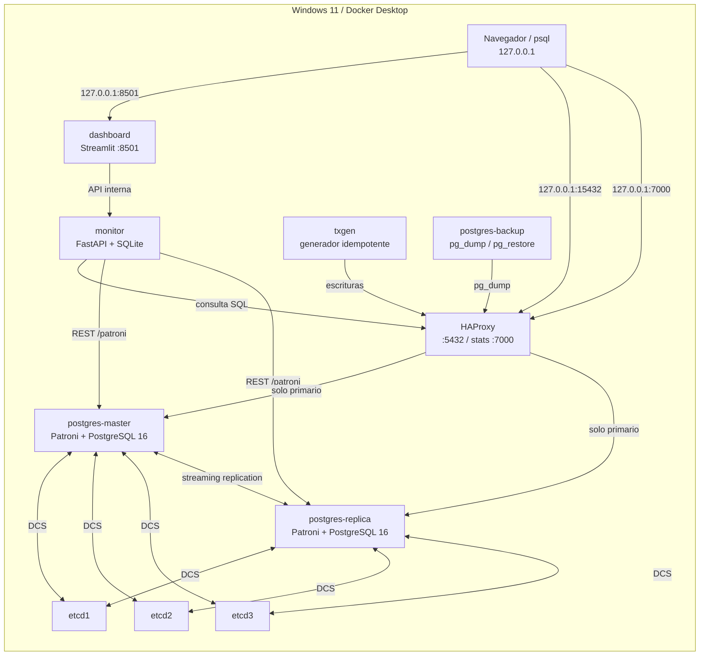

# ClusterDB Monitor

Laboratorio local de **alta disponibilidad PostgreSQL** con failover real, quórum
de etcd, HAProxy, respaldos verificados, generador de transacciones y un dashboard
de KPIs. Todo corre en **una sola laptop** con Windows 11 + Docker Desktop/WSL2 y
puede operar sin Internet una vez descargadas las imágenes.

> **Datos vs. objetivos.** El proyecto distingue siempre entre *objetivo
> configurado* (SLA 99.9 %, RTO 30 s, RPO 60 s) y *resultado medido*. Si no hay
> datos suficientes, el dashboard muestra **“Sin datos suficientes”**; no se
> inventan valores ni se presenta el objetivo como si fuera una medición.

---

## 1. ¿Qué demuestra?

- Un clúster PostgreSQL 16 con **Patroni** y **3 miembros de etcd** (tolerancia a
  la caída de un miembro del quórum).
- **Failover real**: se detiene el primario, Patroni promueve la réplica, HAProxy
  redirige las escrituras y el nodo caído **se reincorpora como réplica** sin
  split-brain.
- **Punto único de conexión** mediante HAProxy, que solo envía tráfico al nodo que
  Patroni reporta como primario (`GET /primary` en la API REST).
- **Respaldos lógicos independientes** de la replicación con `pg_dump` en formato
  custom, verificación SHA-256 y listado TOC, retención y restauración **solo a
  una base temporal**.
- **Monitoreo real** de disponibilidad, latencia, replicación, incidentes y
  transacciones, con métricas persistidas en SQLite (independiente de PostgreSQL).
- **Dashboard** con tarjetas de estado, 9 KPIs, 6 gráficos, historial de eventos y
  un laboratorio de fallos con comandos seguros.
- **Pruebas automatizadas** de los cálculos de KPI, de la persistencia SQLite y
  una verificación integral del stack.

---

## 2. Arquitectura



### Redes

| Red | Tipo | Miembros | Propósito |
|---|---|---|---|
| `clusterdb-net` | bridge, `internal: true` | todos los servicios | Plano de datos aislado, sin salida a Internet. |
| `clusterdb-edge` | bridge | solo `haproxy` y `dashboard` | Publicar puertos en `127.0.0.1`. Docker Desktop no publica puertos de contenedores conectados únicamente a una red interna. |

Los servicios de base de datos, respaldo y monitoreo **no** están en
`clusterdb-edge` y no publican puertos al host.

### Servicios

| Servicio | Contenedor | Imagen / versión | Función | Puerto host |
|---|---|---|---|---|
| `postgres-master` | `clusterdb-postgres-master` | `clusterdb/patroni:16.4-4.1.5` | Nodo Patroni con bootstrap habilitado; PostgreSQL 16.4. | — |
| `postgres-replica` | `clusterdb-postgres-replica` | `clusterdb/patroni:16.4-4.1.5` | Nodo Patroni sin bootstrap; se clona por `basebackup`. | — |
| `etcd1`, `etcd2`, `etcd3` | `clusterdb-etcd1..3` | `quay.io/coreos/etcd:v3.5.17` | Quórum de 3; almacén de configuración de Patroni. | — |
| `haproxy` | `clusterdb-haproxy` | `haproxy:2.9.9-alpine` | Punto único TCP; health check HTTP a `/primary`. | `127.0.0.1:15432`, `127.0.0.1:7000` |
| `postgres-backup` | `clusterdb-postgres-backup` | `clusterdb/backup:16.4` | `pg_dump`/`pg_restore`, verificación y retención. | — |
| `monitor` | `clusterdb-monitor` | `clusterdb/monitor:1.0` | Recolección cada 2 s, KPIs, incidentes, API. | — |
| `txgen` | `clusterdb-txgen` | `clusterdb/txgen:1.0` | Genera ventas idempotentes para medir transacciones. | — |
| `dashboard` | `clusterdb-dashboard` | `clusterdb/dashboard:1.0` | Streamlit + Plotly; solo lectura de la API. | `127.0.0.1:8501` |

Versiones fijadas (sin `latest`):

- PostgreSQL `16.4-bookworm`; Patroni `4.1.5`; `psycopg2-binary 2.9.10`.
- etcd `v3.5.17`; HAProxy `2.9.9-alpine`; Python `3.12-slim-bookworm`.
- FastAPI `0.115.6`; Uvicorn `0.34.0`; Requests `2.32.3`.
- Streamlit `1.41.1`; Plotly `5.24.1`; pandas `2.2.3`.

---

## 3. Requisitos

- Windows 11 con Docker Desktop y WSL2, o Linux con Docker Engine + Compose v2.
- 4 vCPU y 6 GB de RAM disponibles como mínimo; el stack está limitado a ~5 GB.
- Puertos libres en `127.0.0.1`: `15432`, `7000`, `8501`.
- PowerShell 5.1+ (Windows) o Bash 5+ (Linux/WSL/Git Bash).

---

## 4. Inicio rápido

### Windows (PowerShell)

```powershell
cd clusterdb-monitor
.\scripts\init-env.ps1      # crea .env con contraseñas aleatorias
.\scripts\up.ps1            # construye, levanta y espera healthchecks
.\scripts\status.ps1
```

Si la política de ejecución bloquea los scripts:

```powershell
powershell -NoProfile -ExecutionPolicy Bypass -File .\scripts\up.ps1
```

### Linux / WSL / Git Bash

```bash
cd clusterdb-monitor
chmod +x scripts/*.sh tests/*.sh
./scripts/init-env.sh
./scripts/up.sh
./scripts/status.sh
```

### URLs locales

| Recurso | URL |
|---|---|
| Dashboard | <http://127.0.0.1:8501> |
| Estadísticas de HAProxy | <http://127.0.0.1:7000> |
| PostgreSQL por HAProxy | `postgresql://app@127.0.0.1:15432/cluster_demo` |

La contraseña de `app` está en `.env` (`APP_PASSWORD`). `.env` está en
`.gitignore` y **no** se versiona.

### Preparación sin Internet

Antes de la presentación, con Internet:

```powershell
docker compose build
docker compose pull
```

Después se puede arrancar sin red externa:

```powershell
.\scripts\up.ps1 -Offline
```

El plano de datos ya es `internal: true`; el dashboard y HAProxy no necesitan
Internet para funcionar.

---

## 5. Comandos principales

| Windows | Linux/WSL | Qué hace |
|---|---|---|
| `.\scripts\init-env.ps1` | `./scripts/init-env.sh` | Crea `.env` con secretos aleatorios; no sobrescribe salvo `-Force`/`--force`. |
| `.\scripts\up.ps1` | `./scripts/up.sh` | Construye, levanta y espera a que los 10 servicios estén saludables. |
| `.\scripts\down.ps1` | `./scripts/down.sh` | Detiene el stack conservando volúmenes. |
| `.\scripts\down.ps1 -Volumes -Yes` | `./scripts/down.sh --volumes --yes` | Elimina también los volúmenes (bootstrap desde cero). |
| `.\scripts\status.ps1` | `./scripts/status.sh` | Estado, roles, lag, KPIs, respaldos y `patronictl list`. |
| `.\scripts\backup.ps1 -Wait` | `./scripts/backup.sh --wait` | Solicita un respaldo y espera el resultado verificado. |
| `.\scripts\restore-backup.ps1 -Latest -Yes` | `./scripts/restore-backup.sh --latest --yes` | Restaura a una base temporal (requiere `ALLOW_RESTORE=true`). |
| `.\scripts\failover-test.ps1 -Yes` | `./scripts/failover-test.sh --yes` | Failover real, reincorporación y verificación anti split-brain. |
| `.\scripts\verify.ps1` | `./scripts/verify.sh` | Verificación integral no destructiva (10 comprobaciones). |
| `.\tests\run-unit-tests.ps1` | `./tests/run-unit-tests.sh` | 30 pruebas unitarias en un contenedor Python aislado. |
| `.\tests\run-dashboard-smoke.ps1` | `./tests/run-dashboard-smoke.sh` | Smoke test del dashboard con `AppTest`: 0 excepciones, 6 gráficos y tabla de eventos. |

`verify.ps1 -RunBackup` / `verify.sh --backup` ejecuta además un respaldo nuevo
antes de comprobarlo.

---

## 6. Demostración de failover real

```powershell
# Windows
.\scripts\failover-test.ps1 -Yes
```

```bash
# Linux/WSL
./scripts/failover-test.sh --yes
```

El script:

1. Lee el primario actual desde el monitor (no asume que sea `postgres-master`).
2. Ejecuta `docker compose stop` sobre el nombre del primario actual.
3. Espera a que Patroni promueva la réplica y a que HAProxy entregue un nodo
   escribible.
4. Espera a que el monitor cierre el incidente y calcule RTO/RPO.
5. Reinicia el nodo caído y comprueba que vuelva como **réplica en streaming**.
6. Ejecuta una verificación activa (escribe un latido y lo busca en la réplica).
7. Comprueba que exista **un solo primario** y muestra `patronictl list`.

Comandos manuales equivalentes (solo si se quiere explicar en vivo):

```powershell
docker compose stop postgres-master
# Patroni promueve postgres-replica
docker compose start postgres-master
```

> No se debe montar el socket de Docker en ningún contenedor. Las acciones
> destructivas se ejecutan desde la CLI del host, no desde el dashboard.

### Evidencia de la validación final

| Métrica | Resultado medido |
|---|---|
| Failover | `postgres-master` → `postgres-replica` |
| RTO / recuperación medida por el monitor | **4.7 s** (objetivo 30 s, cumple) |
| RPO observado | **0 registros perdidos** (verificado en el nodo promovido) |
| Reincorporación del nodo caído | **4.4 s** como réplica en streaming |
| Split-brain | No; un solo primario |
| Réplica | `postgres-master` en streaming, lag 0 bytes |
| Verificación activa | 6/6 comprobaciones OK |

La disponibilidad y el SLA dependen de la ventana de observación. En una ventana
corta que contiene el failover, la disponibilidad baja de forma visible; al
acumular tiempo sin fallos vuelve a subir. El dashboard muestra la ventana usada
y el margen frente al objetivo. **No se reporta el 99.9 % configurado como si
fuera disponibilidad medida.**

---

## 7. Respaldos y restauración

- `postgres-backup` se conecta por **HAProxy** al primario actual y ejecuta
  `pg_dump -Fc` (formato custom). No depende de la replicación física.
- Cada respaldo se verifica con **SHA-256** y `pg_restore --list` (TOC).
- Retención por días y por cantidad (`BACKUP_RETENTION_DAYS`,
  `BACKUP_RETENTION_COUNT`).
- La restauración está **bloqueada por defecto** (`ALLOW_RESTORE=false`).
- Cuando se habilita, restaura **solo** a una base temporal
  `cluster_demo_restore_YYYYMMDD_HHMMSS`; nunca sobrescribe `cluster_demo`.
- Se conservan las 2 bases temporales más recientes para inspección.

Para habilitar la restauración solo durante la demo:

```powershell
$env:ALLOW_RESTORE = 'true'
docker compose up -d --no-deps --force-recreate postgres-backup monitor dashboard
.\scripts\restore-backup.ps1 -Latest -Yes
```

Al terminar, se deshabilita de nuevo:

```powershell
Remove-Item Env:\ALLOW_RESTORE
docker compose up -d --no-deps --force-recreate postgres-backup monitor dashboard
```

En Linux/WSL: `export ALLOW_RESTORE=true` / `unset ALLOW_RESTORE`.

---

## 8. Pruebas

```powershell
# Unitarias (KPI + SQLite), en contenedor aislado sin red
.\tests\run-unit-tests.ps1

# Smoke test del dashboard (requiere el stack levantado)
.\tests\run-dashboard-smoke.ps1

# Verificación integral del stack
.\scripts\verify.ps1

# Verificación + respaldo nuevo
.\scripts\verify.ps1 -RunBackup
```

```bash
./tests/run-unit-tests.sh
./tests/run-dashboard-smoke.sh
./scripts/verify.sh
./scripts/verify.sh --backup
```

Resultado esperado de las unitarias: **30 pruebas OK**. El smoke test del
dashboard debe reportar **0 excepciones, 6 gráficos Plotly y 1 tabla de
eventos**.

La verificación integral comprueba: 10 contenedores saludables, quórum etcd 3/3,
topología Patroni (1 primario + 1 réplica), replicación activa, API y muestras,
respaldo verificado, dashboard, estadísticas de HAProxy, puerto PostgreSQL y
ausencia de split-brain.

Más detalle en [`docs/pruebas.md`](docs/pruebas.md).

---

## 9. Dashboard y KPIs

El dashboard muestra:

- **Tarjetas de estado**: servicio HAProxy, nodo primario, nodo réplica,
  replicación, respaldos y generador.
- **9 KPIs**: disponibilidad, SLA, MTTR, MTBF, RTO observado, RPO observado,
  último failover, fallos detectados y transacciones OK/fallidas.
- **6 gráficos**: disponibilidad, latencia, retraso de replicación, transacciones
  por intervalo, recuperación de failovers (RTO) y tamaño de respaldos.
- **Historial de eventos** con hora local, tipo, nodo, descripción, resultado y
  severidad.
- **Laboratorio de fallos**: comandos CLI para provocar y recuperar el failover;
  acciones seguras de verificación y respaldo; restauración deshabilitada por
  defecto.

Definiciones y fórmulas en [`docs/kpis.md`](docs/kpis.md).

---

## 10. Seguridad

- Sin socket de Docker montado en ningún contenedor.
- Red de datos `internal: true`; solo HAProxy y dashboard publican puertos, y
  únicamente en `127.0.0.1`.
- `.env` fuera de Git; `init-env` genera contraseñas aleatorias.
- Contenedores de aplicación sin privilegios (`no-new-privileges`, usuarios no
  root donde aplica).
- Imágenes y dependencias con versión fijada; sin `latest`.
- Restauración bloqueada por defecto y limitada a bases temporales.
- El dashboard no ejecuta `docker stop` ni `docker start`; esas acciones se
  documentan como comandos de CLI.

---

## 11. Limitaciones conocidas

- Es un laboratorio de una sola laptop, no un entorno de producción ni un DR
  geográfico.
- La replicación síncrona es **no estricta** (`synchronous_mode_strict: false`):
  permite promover aunque no haya standby síncrono. El RPO de 0 registros es el
  resultado medido en esta prueba, no una garantía universal.
- El SLA 99.9 % es un objetivo operativo. En ventanas de demostración de pocos
  minutos, cualquier failover hace que el SLA no se cumpla; el dashboard lo
  muestra con su margen real.
- El respaldo es lógico (`pg_dump`), no PITR. Su RPO es el intervalo de respaldo
  (6 h por defecto), distinto del RPO de replicación.
- El quórum tolera la caída de 1 de 3 etcd. Si se pierden 2, se detiene la
  coordinación (comportamiento intencional para evitar split-brain).
- El monitor mide la disponibilidad **a través de HAProxy**. Si HAProxy falla, se
  registra indisponibilidad aunque PostgreSQL siga sano; es la definición de
  servicio del proyecto.
- Los datos (`clientes`, `productos`, `ventas`) son de demostración.
- La restauración no sobrescribe la base activa; para recuperación real se
  requeriría un procedimiento operativo adicional.

---

## 12. Documentación

- [`docs/arquitectura.md`](docs/arquitectura.md): componentes, redes, puertos,
  configuración de Patroni/etcd/HAProxy y flujo de failover.
- [`docs/kpis.md`](docs/kpis.md): definición y fórmula de cada KPI, fuentes de
  datos y tratamiento de “sin datos suficientes”.
- [`docs/guion-exposicion.md`](docs/guion-exposicion.md): guion paso a paso para
  la presentación y plan de contingencia.
- [`docs/pruebas.md`](docs/pruebas.md): pruebas unitarias, integrales, de
  failover y de respaldo/restauración, con resultados.

---

## 13. Publicar en GitHub

El repositorio ya tiene un commit inicial en la rama `main`. Solo falta crear el
remoto y subirlo:

1. Crea un repositorio **vacío** en GitHub (sin README, `.gitignore` ni
   licencia; ya están incluidos aquí).
2. Desde esta carpeta, ejecuta:

```powershell
git remote add origin https://github.com/TU_USUARIO/clusterdb-monitor.git
git branch -M main
git push -u origin main
```

3. Comprueba que no se subió `.env`:

```powershell
git check-ignore -v .env
```

Debe mostrar `.gitignore:2:.env`. Las contraseñas se generan en local con
`.\scripts\init-env.ps1` y **nunca** se versionan.

GitHub Actions ejecuta automáticamente, en cada `push` y `pull request`:

- Validación de `docker-compose.yml` (`docker compose config --quiet`).
- Las 30 pruebas unitarias de KPIs y SQLite.

---

## 14. Estructura del repositorio

```text
clusterdb-monitor/
├── docker-compose.yml
├── .env.example                 # plantilla sin secretos (el .env real está ignorado)
├── .gitattributes
├── .github/workflows/ci.yml
├── LICENSE                      # MIT
├── docker/
│   ├── haproxy/haproxy.cfg
│   └── patroni/            # Dockerfile, entrypoint, plantilla, SQL de bootstrap
├── monitor/                # FastAPI, colector, KPIs, SQLite
├── dashboard/              # Streamlit + Plotly
├── backup/                 # pg_dump/pg_restore + verificación
├── txgen/                  # generador idempotente de ventas
├── scripts/                # PowerShell y Bash
├── tests/                  # pruebas unitarias y runners
└── docs/                   # documentación en español
```
